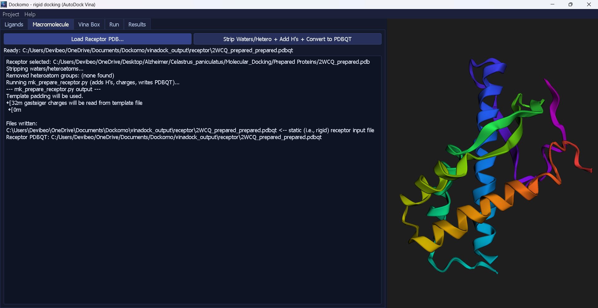
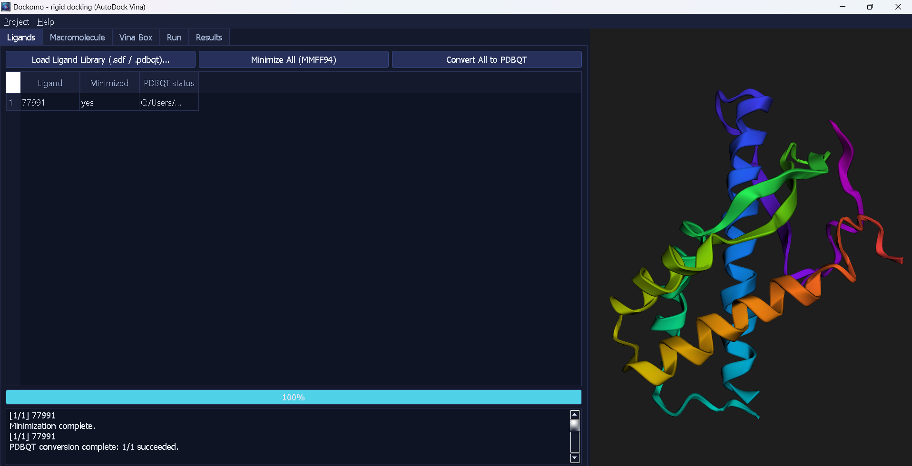
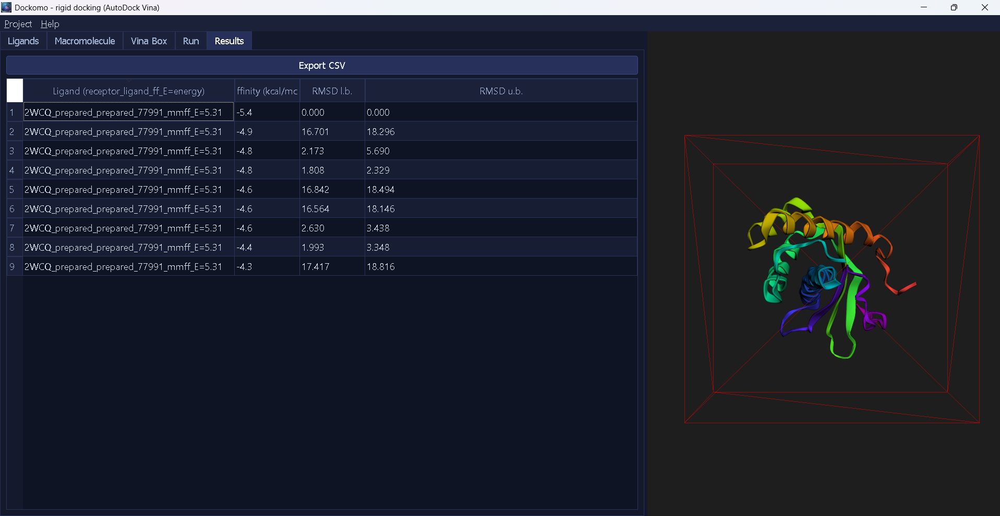

# Dockomo

A batch molecular docking GUI for Windows, built around [AutoDock Vina](https://vina.scripps.edu/).
Load a receptor and a ligand library, auto-detect the search box, run a
batch dock, and browse results — all from one desktop app, with an
embedded 3D viewer and no command-line work required.

Built with PyQt5, RDKit, and Meeko.

## Screenshots





## Features
- Load ligands from `.sdf`, `.mol2`, `.pdb`, or already-prepared `.pdbqt`
- MMFF94 (UFF fallback) ligand minimization
- Receptor prep: strip waters/heteroatoms, protonate, convert to PDBQT —
  or load an already-prepared receptor `.pdbqt` directly
- Auto-detect the Vina search box around the whole protein or a specific
  chain/residue
- Batch docking with a fixed seed for reproducible results
- Embedded 3D viewer (receptor, ligand poses, and search box) via 3Dmol.js
- Results grouped by ligand, exportable to CSV
- Save/load full project sessions

## Installing (Windows)
Download the latest `DockomoSetup.exe` from the
[Releases](../../releases) page and run it. AutoDock Vina is bundled — no
separate downloads or PATH setup needed.

> **A console window briefly appears during docking.** This is
> AutoDock Vina running in the background, not an error — leave it be
> (minimize it if it's in the way) and it will close on its own once
> the batch finishes. Closing it manually will stop the docking run.

## Running from source
Requires Python 3.10+ on Windows.

```
python -m venv venv
venv\Scripts\activate
pip install -r requirements.txt
python main.py
```

## Building the installer yourself
See [PACKAGING_README.md](PACKAGING_README.md) for the full PyInstaller +
Inno Setup build process, including why the build uses onedir mode and
how RDKit/Meeko's data files get collected.

Short version:
```
pip install pyinstaller
pyinstaller Dockomo.spec
iscc Dockomo.iss
```

## Project layout
```
Dockomo/
├── main.py              entry point
├── core/
│   ├── paths.py          frozen-safe path resolution (installer vs. source)
│   ├── prep.py           ligand/receptor preparation (RDKit + Meeko)
│   ├── docking.py        vina.exe subprocess wrapper
│   └── project.py        save/load project sessions
├── ui/
│   ├── main_window.py     main application window
│   ├── viewer.py          embedded 3D viewer (3Dmol.js)
│   └── workers.py         background QThread worker
├── assets/                icon, etc.
├── vina/                  bundled vina.exe (see below)
├── docs/screenshots/       README images
├── Dockomo.spec            PyInstaller build spec
└── Dockomo.iss             Inno Setup installer script
```

## AutoDock Vina binary
`vina/vina.exe` is included in this repository so the build is
reproducible and the installer is fully self-contained. It's licensed
under Apache License 2.0 (see [THIRD_PARTY_NOTICES.md](THIRD_PARTY_NOTICES.md)),
which permits redistribution. If you'd rather not commit a binary to the
repo, remove it from git, add `vina/vina.exe` to `.gitignore`, and note in
your own fork that it must be downloaded separately before building.

## License
Dockomo is licensed under the [GNU GPLv3](LICENSE) — see
[THIRD_PARTY_NOTICES.md](THIRD_PARTY_NOTICES.md) for why (PyQt5).

## Author
Karan Kataria
